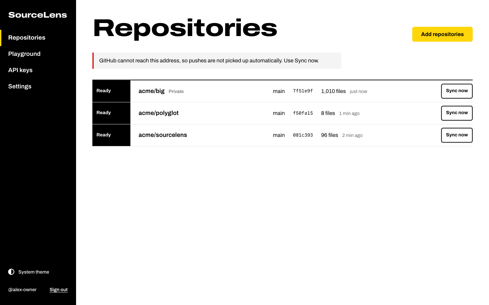
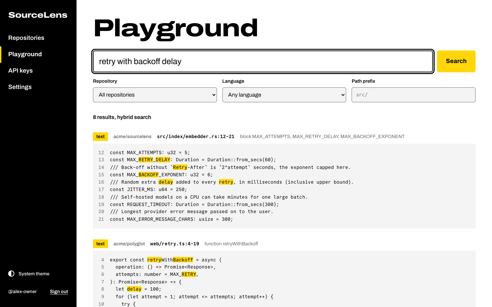

# SourceLens Lite

SourceLens Lite indexes the GitHub repositories you choose and lets coding agents search them over MCP, without a local checkout.

- Your agent (Claude Code, Cursor, VS Code or any other MCP client) can search code, find where a symbol is defined and read files in repositories that are not on your machine: other services, shared libraries, the rest of the organisation.
- The index follows one branch per repository. A push to that branch re-indexes only the files that changed.
- It runs as one container with one SQLite file. A web UI handles setup, repositories, API keys and a search playground.



## What an agent gets

After you add the MCP endpoint to your agent, it can call tools like these. A `find_symbol` call:

```json
{ "name": "find_symbol", "arguments": { "name": "getUserById" } }
```

returns where the symbol is defined, with its signature:

```text
1. function getUserById — acme/api src/users.ts:9-16
   function getUserById(id: string): User | undefined
```

A `search_code` call with plain words, `{ "query": "user id lookup" }`, returns the matching code blocks with repository, path and line range (first of three results shown):

````text
3 results for "user id lookup" (lexical)

1. acme/api src/users.ts:1-16  block User, users, getUserById
```typescript
export interface User {
  id: string;
  name: string;
  email: string;
}

const users = new Map<string, User>();

export function getUserById(id: string): User | undefined {
  // Look the user up in the in-memory store.
  const user = users.get(id);
  if (!user) {
    return undefined;
  }
  return user;
}
```
````

Both outputs come from the test fixtures in this repository. The agent can then read more of the file with `get_code`.



## How it works

1. **GitHub App.** SourceLens creates a GitHub App for you (or uses one you provide) with read-only access (`Contents: read`, `Metadata: read`). You install it on the repositories it may read. Users sign in with GitHub.
2. **Index.** For each connected repository SourceLens indexes one branch (the default branch unless you pick another). Files are split into chunks along functions, classes and methods with tree-sitter; definitions go into a symbol table; everything goes into a full-text index. On a `push` webhook, SourceLens compares the Git tree with the indexed one and fetches and re-indexes only changed files.
3. **Embeddings (optional).** If you configure an OpenAI-compatible embeddings endpoint, chunks are also embedded and search adds results by meaning.
4. **MCP.** A read-only MCP endpoint at `/mcp` answers agents. Each request needs an API key created in the UI.

One binary (Rust, with the React UI embedded), one SQLite database, no other services.

## Quick start with Docker

```sh
docker run -d --name sourcelens \
  -p 3000:3000 \
  -e SOURCELENS_PUBLIC_URL=http://localhost:3000 \
  -v sourcelens-data:/data \
  ghcr.io/alxbiermann/sourcelens-lite:latest

docker logs sourcelens
```

The log contains a line like:

```text
Setup token: 3f9c…e1 — open http://localhost:3000/setup
```

The token is printed at every start until an owner exists, and it changes with every start. Then:

1. **Open `/setup`** (`http://localhost:3000/setup`).
2. **Create the GitHub App.** Paste the setup token, optionally enter an organization (leave it empty for your personal account) and click "Create GitHub App". GitHub shows the app it is about to create; confirm it. GitHub sends you back to SourceLens, which stores the app credentials.
3. **Install it.** Click "Install on GitHub" and choose the repositories SourceLens may read. You can change this later on GitHub.
4. **Sign in.** Click "Sign in with GitHub". The first person who signs in with the setup token becomes the owner of the instance.
5. **Connect repositories.** On "Repositories", click "Add repositories" and "Connect" next to each repository. Indexing starts at once; the row shows Queued, Indexing and then Ready.
6. **Create an API key.** On "API keys", click "Create key", choose an expiry and which repositories the key may search. The key is shown once.
7. **Configure your agent.** The same dialog shows ready-to-paste configuration for Claude Code, Cursor, VS Code and other MCP clients, with the real key filled in (see [Connecting agents](#connecting-agents)).

**On `localhost`** GitHub cannot deliver webhooks, so pushes are not picked up automatically. SourceLens creates the app with its webhook switched off and shows "GitHub cannot reach this address, so pushes are not picked up automatically. Use Sync now." Click "Sync now" on a repository to index its latest commit. Everything else works. For a permanent setup, see [Hosting](#hosting).

Other people sign in after the owner adds their GitHub username under Settings → Members.

## Connecting agents

The MCP URL is `SOURCELENS_PUBLIC_URL` followed by `/mcp`, for example `https://sourcelens.example.com/mcp`. Every request needs the header `Authorization: Bearer <key>`; keys start with `sl_`.

Claude Code (run in a terminal):

```sh
claude mcp add --transport http sourcelens https://sourcelens.example.com/mcp --header "Authorization: Bearer sl_..."
```

Cursor (`~/.cursor/mcp.json`); other MCP clients use the same shape:

```json
{
  "mcpServers": {
    "sourcelens": {
      "url": "https://sourcelens.example.com/mcp",
      "headers": {
        "Authorization": "Bearer sl_..."
      }
    }
  }
}
```

VS Code (`.vscode/mcp.json`):

```json
{
  "servers": {
    "sourcelens": {
      "type": "http",
      "url": "https://sourcelens.example.com/mcp",
      "headers": {
        "Authorization": "Bearer sl_..."
      }
    }
  }
}
```

To check a key from the command line:

```sh
curl -s https://sourcelens.example.com/mcp \
  -H "Authorization: Bearer sl_..." \
  -H "content-type: application/json" \
  -d '{"jsonrpc":"2.0","id":1,"method":"tools/call","params":{"name":"list_repositories","arguments":{}}}'
```

### Tools

All tools are read-only. Repository names are full names (`owner/repo`), matched case-insensitively within the key's access.

| Tool | What it does |
|---|---|
| `list_repositories` | Lists the repositories the key can search, with branch, indexed commit and file count. |
| `search_code` | Searches by keywords, identifiers or (with embeddings) meaning. Arguments: `query`, optional `repositories`, `languages`, `pathPrefix`, `limit` (1–20, default 8). |
| `get_code` | Reads a file or a line range (`startLine`, `endLine`). Without a range it returns the first 400 lines; at most 800 lines per call. |
| `get_file_outline` | Lists the symbols of one file with kinds, signatures and line ranges. |
| `find_symbol` | Finds where a function, class, type or other symbol is defined: exact names first, then prefixes, then substrings. Optional `repositories`, `kind`, `limit` (1–50, default 20). |

Protocol details: stateless Streamable HTTP with JSON responses (`POST /mcp` only; `GET` and `DELETE` answer 405), protocol versions `2025-11-25`, `2025-06-18` and `2025-03-26`. Each key may send 10 requests per second with bursts of up to 20; above that the server answers 429.

API keys can access all connected repositories (including ones connected later) or a selected list, and expire after 30 days, 90 days, 1 year or never. A revoked key stops working immediately.

## Search

`search_code` (and the Playground in the UI) combine up to three ways of finding code and merge their rankings:

- **Symbol lookup.** Words that look like identifiers (`getUserById`, `Order.total`, `parse_header`) are looked up in the table of definitions: exact name, then prefix, then substring. A match here counts double.
- **Keyword search.** Full-text search over symbol names, paths and code. Identifiers are also split into their parts, so `user id lookup` finds `getUserById`. Chunks that contain all words get a higher score than chunks that contain only some.
- **Semantic search** (only with embeddings). The query is embedded and compared with the chunk vectors.

The response says which mode ran: `lexical` or `hybrid`. Test files rank lower unless the query mentions tests, and import blocks rank lower. At most three results come from the same file.

Results are chunks: a function, a method, a class that fits in one chunk, or a group of small neighbouring declarations. Large classes are split into their members.

### Languages

| Support | Languages |
|---|---|
| Chunks along declarations and symbols (tree-sitter) | C, C++, C#, Go, Java, JavaScript, Kotlin, PHP, Python, Ruby, Rust, Scala, TypeScript (including TSX) |
| Sections and headings as symbols | Markdown |
| Indexed as text, in line windows | Every other text file, for example YAML, JSON, SQL, shell, Terraform, Dockerfiles |

Not indexed: files larger than `SOURCELENS_MAX_FILE_BYTES` (1 MiB by default), binary files, minified files, generated files (for example `.pb.go`, `_pb2.py`, or a `@generated` / `Code generated … DO NOT EDIT` marker in the first ten lines), lockfiles, vendored directories (`node_modules`, `vendor`, `third_party`, …), symlinks and submodules.

## Embeddings

Embeddings are optional. Without them, symbol and keyword search work as described above.

The owner configures them under Settings → Embeddings. SourceLens calls any server that speaks the OpenAI embeddings API (`POST {base URL}/embeddings`), for example OpenAI, Ollama or LM Studio. Fields: base URL, API key (optional), model, dimensions (optional), query prefix, document prefix, batch size (1–256, default 32). "Test connection" checks the settings without saving them. Saving tests them again and records the vector dimensions; on the first save, and after a change that affects the vectors, every connected repository is embedded.

Example with [Ollama](https://ollama.com):

```sh
ollama pull nomic-embed-text
```

| Field | Value |
|---|---|
| Base URL | `http://localhost:11434/v1` when SourceLens runs on the same host outside Docker; `http://host.docker.internal:11434/v1` from a container (on Linux, start the container with `--add-host=host.docker.internal:host-gateway`) |
| Model | `nomic-embed-text` |
| Query prefix | `search_query: ` |
| Document prefix | `search_document: ` |

Changing the base URL, model, dimensions or document prefix re-embeds all chunks. Turning embeddings off keeps the stored vectors; search stops using them. If the provider fails during a search, that search falls back to `lexical`.

## Configuration

SourceLens reads its configuration from environment variables (and from a `.env` file in the working directory, if present).

| Variable | Default | Meaning |
|---|---|---|
| `SOURCELENS_PUBLIC_URL` | required | External base URL without trailing slash, for example `https://sourcelens.example.com`. Used for the GitHub App, OAuth callback, webhooks and the MCP URL shown in the UI. |
| `SOURCELENS_BIND` | `0.0.0.0:3000` | Listen address. Keep port 3000 in the container image; its health check calls `http://127.0.0.1:3000/healthz`. |
| `SOURCELENS_DATA_DIR` | `./data` (`/data` in the image) | Holds `sourcelens.db`, `secret.key` and `tmp/`. Set to mode 0700 at every start; `tmp/` is emptied at every start. |
| `SOURCELENS_SECRET_KEY` | unset | Base64 of 32 bytes, for example from `openssl rand -base64 32`. Encrypts the GitHub App credentials, GitHub sign-in tokens and the embeddings API key in the database. If unset, `secret.key` is created in the data directory on first start and reused. |
| `SOURCELENS_INDEX_CONCURRENCY` | `2` | Index jobs that run in parallel. |
| `SOURCELENS_MAX_FILE_BYTES` | `1048576` | Larger files are not indexed. |
| `SOURCELENS_MAX_ARCHIVE_BYTES` | `2147483648` | Repository archives larger than this fail the index job. Archives (tarballs) are downloaded when more than 200 files changed or GitHub truncates the file tree of a very large repository. |
| `SOURCELENS_DEV_ORIGIN` | unset | Extra browser origin allowed to call the API, for the UI dev server. |
| `RUST_LOG` | `info` | Log filter. |

### GitHub App from the environment

Instead of the manifest flow on `/setup`, you can create a GitHub App yourself and pass its credentials. Set all six variables or none; a partial set stops the server with `Missing GitHub App variables: …`.

| Variable | Value |
|---|---|
| `SOURCELENS_GITHUB_APP_ID` | The app's numeric ID. |
| `SOURCELENS_GITHUB_APP_SLUG` | The app's URL name (`https://github.com/apps/<slug>`). |
| `SOURCELENS_GITHUB_CLIENT_ID` | The app's client ID. |
| `SOURCELENS_GITHUB_CLIENT_SECRET` | A client secret of the app. |
| `SOURCELENS_GITHUB_WEBHOOK_SECRET` | The webhook secret set in the app. |
| `SOURCELENS_GITHUB_PRIVATE_KEY_PATH` | Path to the app's private key (`.pem`). In a container, mount the file and make it readable for the container user (uid 10001). |

Configure the app like the one SourceLens would create: repository permissions `Contents: read` and `Metadata: read`; events `Push` and `Repository`; callback URL `<public URL>/auth/github/callback`; webhook URL `<public URL>/webhooks/github` with the webhook secret; optionally setup URL `<public URL>/repositories?installed=1`. With these variables set, `/setup` shows step 1 as done; you still install the app and sign in with the setup token.

## Hosting

A production setup needs:

- **A URL that your users' browsers can open.** Set `SOURCELENS_PUBLIC_URL` to it; HTTPS through a reverse proxy that terminates TLS is recommended. It does not have to be reachable from the internet: only the webhook path must be, and only if pushes should be indexed automatically (see [Network exposure](#network-exposure)).
- **The final URL before you create the GitHub App.** The app stores the webhook URL and callback URL from the moment it is created. An app created for a `localhost` URL has its webhook switched off, so set up the production instance with its final URL from the start (a fresh data volume runs the setup again). If the URL changes later, set the new `SOURCELENS_PUBLIC_URL` and update the app on GitHub: `https://github.com/settings/apps/<slug>` for an app on a personal account, `https://github.com/organizations/<org>/settings/apps/<slug>` for an organization app. Change "Homepage URL", "Callback URL", "Setup URL" and, under "Webhook", the webhook URL.
- **A persistent volume for `/data`.** It holds the SQLite database with the indexed source code of every connected repository, and `secret.key`. Treat it like the source code itself: restrict access and back it up. Without `secret.key` (or the same `SOURCELENS_SECRET_KEY`), the stored GitHub App credentials cannot be decrypted.
- **One instance per team.** Every member can search every connected repository, and every member can connect any repository that both they and the GitHub App can read. Run separate instances for groups that must not see each other's code.

The container listens on port 3000, runs as a non-root user (uid 10001) and has a Docker health check on `GET /healthz`. If you mount a host directory instead of a named volume at `/data`, it must be writable by uid 10001.

### Network exposure

SourceLens can run inside a company network with the UI, the API and the MCP endpoint reachable only from there. The only request that comes from the internet is GitHub's webhook delivery, and that one is optional.

| Endpoint | Called by | Must be reachable from |
|---|---|---|
| `POST /webhooks/github` | GitHub's webhook servers | The internet, only if pushes should be indexed automatically |
| `GET /auth/github/login`, `GET /auth/github/callback` | The user's browser, sent to and back from github.com during sign-in | Users' browsers |
| `GET /auth/github/app-created`, `GET /repositories?installed=1` | The user's browser, sent back from github.com after creating and after installing the GitHub App | Users' browsers |
| `/` and the static assets of the UI | Users' browsers | Users' browsers |
| `/api/*` | The UI | Users' browsers |
| `POST /mcp` | Agents | Machines that run agents |
| `GET /healthz` | The container health check, load balancers | The host or orchestrator |

- **`/webhooks/github`** checks the `X-Hub-Signature-256` header, an HMAC-SHA256 of the raw body with the app's webhook secret. A request without a valid signature gets 401 (`invalid_signature`); if no webhook secret is configured, every request gets 404 (`webhooks_disabled`). Bodies are limited to 8 MiB, and a repeated delivery ID is answered 200 and ignored. Without webhooks, "Sync now" and the index job that runs for every repository at each start keep the index current.
- **Sign-in, app creation and installation** need nothing public. GitHub only redirects the user's browser to these URLs; the server then exchanges the code with GitHub through outbound calls. `SOURCELENS_PUBLIC_URL` can therefore be an internal hostname that resolves only inside the network, as long as your users' browsers can open it. The browsers themselves need `github.com` (and `avatars.githubusercontent.com` for avatars in the UI).
- **`/api/*`** requires the session cookie set after GitHub sign-in (except `GET /api/state`, which the UI reads before sign-in). Requests other than `GET`, `HEAD` and `OPTIONS` must also carry an `Origin` header equal to the origin of `SOURCELENS_PUBLIC_URL` (or `SOURCELENS_DEV_ORIGIN`); others get 403 (`origin_not_allowed`).
- **`/mcp`** requires an API key; requests from browsers are accepted only from the origin of `SOURCELENS_PUBLIC_URL`. It needs to be reachable from outside only for agents that do not run inside the network, for example hosted agents or CI runners. The API key is then the only protection: 256 random bits, stored as a SHA-256 hash, limited to the repositories chosen for the key, with an optional expiry, revocable at once. The per-key rate limit counts only requests with a valid key, so add a rate limit on the reverse proxy and forward nothing but `POST /mcp` from outside.

Outbound, the server connects to:

| Host | Used for |
|---|---|
| `api.github.com` | GitHub REST API: app and installation tokens, branches, file trees, file contents, repository archives, the signed-in user, member lookup, the conversion of the app manifest |
| `github.com` | OAuth: exchanging the sign-in code for a token and refreshing it (`/login/oauth/access_token`) |
| `codeload.github.com` | Repository archives: GitHub answers the archive request on `api.github.com` with a redirect to this host, which the server follows. Archives are used when more than 200 files changed or GitHub truncates the file tree of a very large repository |
| The embeddings base URL | Embeddings, only if configured |

The server's HTTP client uses the proxy given in `HTTPS_PROXY`, `HTTP_PROXY` or `ALL_PROXY` and skips it for hosts listed in `NO_PROXY` (for example an internal embeddings server).

#### Private network with webhooks

To have pushes indexed automatically, let GitHub reach `POST /webhooks/github` and nothing else. The webhook handler does not look at the `Host` header, is not subject to the `Origin` check and does not use `SOURCELENS_PUBLIC_URL`, so the delivery can arrive through any hostname as long as the path, method, headers and body reach the instance unchanged.

(a) **Same hostname, split DNS.** Inside the network, the hostname of `SOURCELENS_PUBLIC_URL` resolves to the instance. On the internet, it resolves to a reverse proxy that forwards only the webhook. A Caddyfile for that proxy (`10.0.0.12:3000` stands for the instance):

```text
sourcelens.example.com {
	@webhook {
		method POST
		path /webhooks/github
	}
	handle @webhook {
		reverse_proxy 10.0.0.12:3000
	}
	handle {
		respond 404
	}
}
```

(b) **Separate public hostname or tunnel**, for example `https://hooks.example.com/webhooks/github` forwarded to the instance. A GitHub App created on `/setup` stores `<SOURCELENS_PUBLIC_URL>/webhooks/github`, so after creating it, change the webhook URL in the app's settings on GitHub (see the settings URLs under the requirements above). Or create the app yourself with the public webhook URL and pass it through the `SOURCELENS_GITHUB_*` variables ([GitHub App from the environment](#github-app-from-the-environment)).

In case (b), Settings → GitHub in SourceLens still shows `<SOURCELENS_PUBLIC_URL>/webhooks/github` as the webhook URL, not the URL configured on GitHub. Its webhook state only reflects the configuration: "Active" whenever a webhook secret exists and `SOURCELENS_PUBLIC_URL` is not `localhost`, `127.0.0.1` or `::1`. "Last delivery" shows whether deliveries actually arrive.

GitHub publishes the source address ranges of webhook deliveries under `hooks` in `https://api.github.com/meta`; use them for an allowlist on the proxy.

#### Private network without webhooks

If GitHub cannot reach the instance at all, SourceLens still works: use "Sync now", and every start indexes what changed. Note that an internal hostname is not `localhost`, so the app created on `/setup` asks GitHub for an active webhook at `<SOURCELENS_PUBLIC_URL>/webhooks/github`. GitHub's deliveries to it fail without effect on SourceLens. Settings → GitHub can still show the webhook as "Active", because that state reflects only the configuration; "Last delivery" stays at "No deliveries yet". To stop the failed deliveries, switch the webhook off in the GitHub App settings ("Active" under "Webhook").

### Docker Compose behind Caddy

`docker-compose.yml`:

```yaml
services:
  sourcelens:
    image: ghcr.io/alxbiermann/sourcelens-lite:latest
    environment:
      SOURCELENS_PUBLIC_URL: https://sourcelens.example.com
    volumes:
      - sourcelens-data:/data
    restart: unless-stopped

  caddy:
    image: caddy:2
    ports:
      - "80:80"
      - "443:443"
    volumes:
      - ./Caddyfile:/etc/caddy/Caddyfile:ro
      - caddy-data:/data
    restart: unless-stopped

volumes:
  sourcelens-data:
  caddy-data:
```

`Caddyfile` (Caddy obtains the TLS certificate itself once DNS for the name points at the host):

```text
sourcelens.example.com {
	reverse_proxy sourcelens:3000
}
```

```sh
docker compose up -d
docker compose logs sourcelens
```

Then follow the first-run steps from the quick start at `https://sourcelens.example.com/setup`.

The `docker-compose.yml` in this repository is the variant without a proxy: it publishes port 3000, reads `.env`, and pulls the published image (`docker compose up -d`) or builds it from source (`docker compose up -d --build`).

### Coolify

1. Add a new resource of type Docker image: `ghcr.io/alxbiermann/sourcelens-lite:latest`.
2. Set the exposed port to `3000` and the domain, for example `https://sourcelens.example.com`.
3. Add the environment variable `SOURCELENS_PUBLIC_URL=https://sourcelens.example.com` (the same URL as the domain).
4. Add persistent storage (a volume) mounted at `/data`.
5. Enable the health check with path `/healthz` on port `3000`.
6. Deploy, open the logs for the setup token and continue at `https://sourcelens.example.com/setup`.

### Upgrades

Pull the new image and recreate the container, for example `docker compose pull && docker compose up -d`. Database migrations run at start. When a new version changes how files are chunked, the next index job of every repository rebuilds its index. At every start, SourceLens also queues an index job per connected repository, which picks up pushes made while it was down.

### Backup

Stop the container (or take an atomic snapshot of the volume), then copy the volume:

```sh
docker stop sourcelens
docker run --rm -v sourcelens-data:/data -v "$PWD":/backup debian:trixie-slim \
  tar czf /backup/sourcelens-data.tar.gz -C /data .
docker start sourcelens
```

If you set `SOURCELENS_SECRET_KEY`, keep it with the backup.

## Container image

`ghcr.io/alxbiermann/sourcelens-lite`, built by GitHub Actions (`.github/workflows/docker.yml`) for `linux/amd64` and `linux/arm64`.

| Tag | Built from |
|---|---|
| `latest` | Every push to `main` |
| `sha-<short sha>` | Every push to `main`, one tag per commit |
| `X.Y.Z`, `X.Y` | Git tags `vX.Y.Z` |

## Building from source and development

Prerequisites: the Rust toolchain pinned in `rust-toolchain.toml` (1.96.1 with clippy and rustfmt, for example via `rustup`) and Node.js 24.

Build the UI first; the binary embeds `ui/dist` at compile time (without it, the server answers web pages with "UI not built"):

```sh
npm --prefix ui ci
npm --prefix ui run build
cp .env.example .env    # then edit SOURCELENS_PUBLIC_URL if needed
cargo run --release
```

Tests and lints:

```sh
cargo test
cargo clippy --all-targets -- -D warnings
```

UI development with hot reload: the Vite dev server runs on `http://127.0.0.1:5173` and proxies `/api`, `/auth`, `/mcp` and `/webhooks` to the server on `http://127.0.0.1:3000`. The server accepts state-changing API calls only from its own origin or `SOURCELENS_DEV_ORIGIN`:

```sh
# terminal 1
SOURCELENS_PUBLIC_URL=http://127.0.0.1:3000 SOURCELENS_DEV_ORIGIN=http://127.0.0.1:5173 cargo run

# terminal 2
npm --prefix ui run dev
```

Use `127.0.0.1` (not `localhost`) in `SOURCELENS_PUBLIC_URL` so the session cookie set after GitHub sign-in is also sent to the dev server; cookies do not depend on the port. The GitHub App's callback URL must use the same host.

## Limits

- GitHub only (github.com). No GitLab, Bitbucket or GitHub Enterprise Server.
- Read-only. SourceLens never writes to GitHub, and the MCP tools only read the index.
- One branch per repository.
- Indexing on push needs GitHub to reach `POST /webhooks/github`. Without that, use "Sync now". There is no periodic polling.
- Failed index jobs are not retried automatically. The next push, a restart or "Sync now" runs the job again.
- Members share access: every member can search all connected repositories. Only the owner manages members and embedding settings.
- Embeddings only through the OpenAI-compatible `/embeddings` API.
- Early version (0.1.0). Expect changes.
